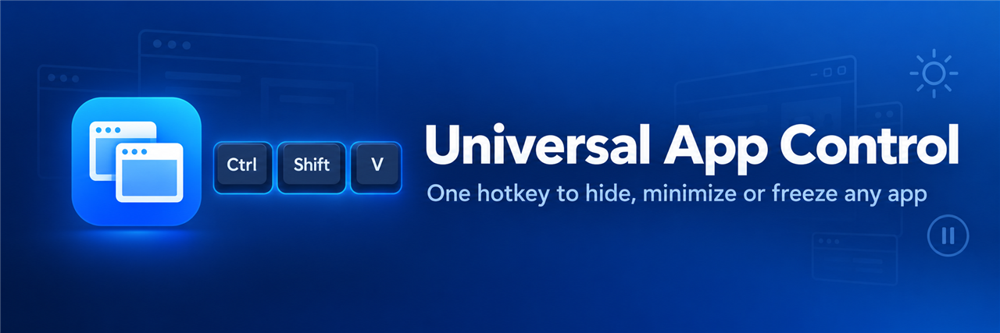
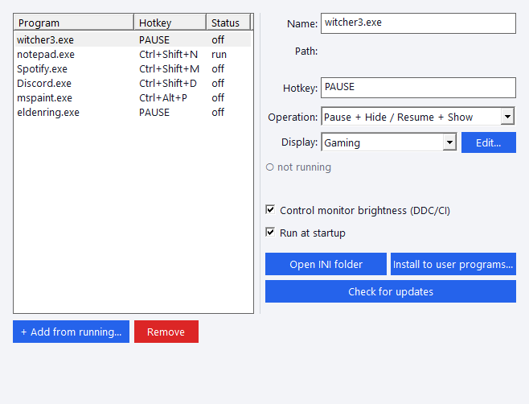
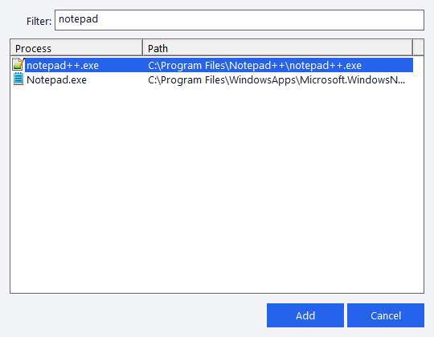
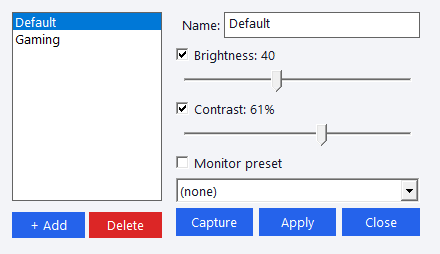

<p align="center">
  
</p>

<p align="center">
  <a href="https://github.com/DrunkenDonkey80/UniversalAppControl/releases/latest"></a>
  <a href="https://github.com/DrunkenDonkey80/UniversalAppControl/actions"></a>
  
  
</p>

**Universal App Control** is a tiny Windows tray app that gives each of your programs its own hotkey.
Press it to bring the program to the front, press it again to get it out of the way: minimize it, hide it completely, or even **freeze a game** so it uses no CPU or GPU while you do something else.
It can also switch your monitor's brightness and contrast to match the app in front.

One small `.exe`, no installer or runtime needed, and it updates itself.

---

## ✨ Features

| | |
|---|---|
| ⌨️ **A hotkey per app** | Toggle any program with a key combination like `Ctrl+Shift+V`, ``Alt+` ``, or just `Pause`. Press it once to bring the app forward, press again to send it away. |
| 🪟 **Minimize / Restore** | Works like AutoHotkey's `WinActivate`: the window comes back in front and **keeps its maximized size**, even if you minimized it yourself or restored it from the taskbar in between. |
| 🙈 **Hide / Show** | Hides the window completely, without even a taskbar button, and shows it again. |
| ⏸️ **Pause + Hide / Resume + Show** | Hides the window **and suspends the whole process**. Great for games: freeze one, do your work, press the key and continue exactly where you were. |
| 🔁 **One key, many apps** | Give several programs the same key (e.g. `Pause` for all your games), and it acts on whichever of them is running. |
| 🔆 **Display presets** (DDC/CI) | Each app can have its own monitor brightness, contrast and monitor mode, applied when it comes to the front; every other app gets the default preset. *(Primary monitor, needs DDC/CI turned on in the monitor's menu.)* |
| 🔄 **Auto-update** | Checks GitHub once a day. When an update is ready, the tray icon gets a red **!** and *Restart to update* appears in the tray menu and in Settings. |
| 📋 **Move your config between PCs** | *Copy config to clipboard* on one PC, *Paste config from clipboard…* on the other. The old config is kept as a `.bak`. |
| 🚀 **Starts with Windows** | One checkbox in Settings or the tray menu. |
| 🪶 **Featherweight** | Plain C and Win32, one small executable, settings in a readable `.ini` file. |

---

## 📸 Screenshots

### Settings

Every app you control is listed on the left. Pick one to set its hotkey, what the hotkey does, and its display preset.

<p align="center"></p>

### Add an app from the running programs

Click **+ Add from running…**, type a few letters to filter, and pick the program.

<p align="center"></p>

### Display presets

Set brightness, contrast and the monitor's own mode per preset. **Capture** reads what the monitor is set to right now, and **Apply** lets you try a preset straight away.

<p align="center"></p>

---

## 🚀 Getting started

1. Download **`UniversalAppControl.exe`** from the [latest release](https://github.com/DrunkenDonkey80/UniversalAppControl/releases/latest).
2. Run it. A tray icon appears, and clicking it opens **Settings**.
3. Click **+ Add from running…** and pick an app.
4. Click in the **Hotkey** field and press the key combination you want.
5. Choose an **Operation**: *Minimize / Restore*, *Hide / Show* or *Pause + Hide / Resume + Show*.
6. Optional: tick **Run at startup**, and use **Install to user programs…** to copy the app to `%LOCALAPPDATA%\Programs\UniversalAppControl` with a Start Menu shortcut.

> **Tip:** Running `UniversalAppControl.exe` again while it is already running just opens Settings.

> **Note:** Windows doesn't let a normal program control windows of apps that run as administrator. To control those, run Universal App Control as administrator too.

## 🖱️ Tray menu

Right-click the tray icon for:

| Item | What it does |
|---|---|
| **Restart to update to x.y.z** | Shown only when an update has been downloaded. |
| **Settings…** | Opens the Settings window (a left-click on the icon does the same). |
| **Unhide hidden apps** | Shows everything that is currently hidden and resumes paused apps. Handy as a panic button. |
| **Run at Windows startup** | Turns starting with Windows on or off. |
| **Install to user programs…** | Copies the app and its config to your user programs folder and adds a Start Menu shortcut. |
| **Open INI folder** | Opens the folder with `UniversalAppControl.ini`. |
| **Copy config to clipboard** / **Paste config from clipboard…** | Moves all your settings to another PC. |
| **Check for updates** | Checks right now instead of waiting for the daily check. |
| **Quit** | Shows and resumes everything it hid or paused (minimized apps stay minimized), then exits. |

## ⚙️ Configuration file

Settings live in `UniversalAppControl.ini`: next to the installed copy if you used *Install to user programs*, otherwise next to the `.exe`. Settings writes it for you, but it is easy to edit by hand:

```ini
[general]
DisplayControl=true
DefaultPreset=Default

[preset:Default]
Brightness=40
Contrast=60

[preset:Gaming]
Brightness=70
Contrast=70

[notepad.exe_0]
ProgramExeName=notepad.exe
Hotkey=Ctrl+Shift+N
Operation=2            ; 0 none, 1 hide/show, 2 minimize/restore, 3 pause+hide

[witcher3.exe_1]
ProgramExeName=witcher3.exe
Hotkey=PAUSE
Operation=3
DisplayPreset=Gaming
```

Hotkeys combine `Ctrl`, `Shift`, `Alt` and `Win` with any key, e.g. `Ctrl+Alt+P`, `Shift+PAUSE`, `Alt+OEM_3` (the `` ` `` key).

## 🛠️ Building from source

Requires **Visual Studio 2026** with the *Desktop development with C++* workload.

```bat
build.bat                                   :: Debug x64 build -> x64\Debug\UniversalAppControl.exe
x64\Debug\UniversalAppControl.exe --selftest
```

Or open `UniversalAppControl.sln` in Visual Studio.
GitHub Actions builds every push, runs the self-test, and publishes a release for every `vX.Y.Z` tag.

## 📜 Changelog

See [CHANGELOG.md](CHANGELOG.md).
